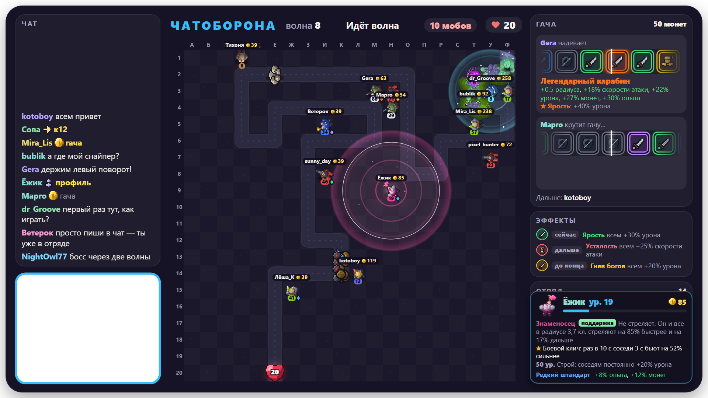
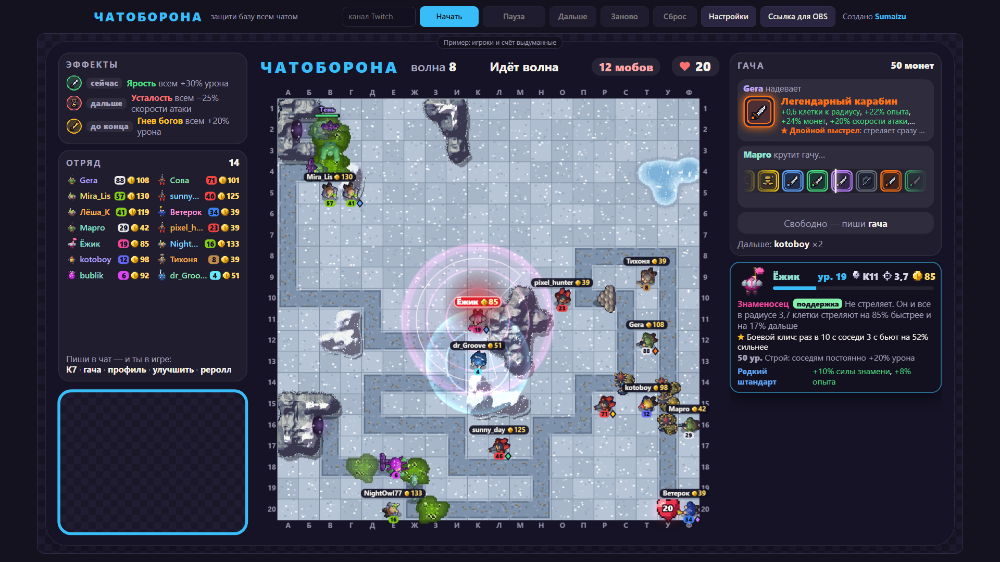
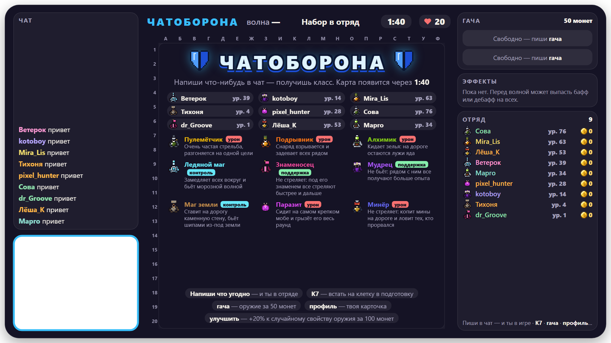
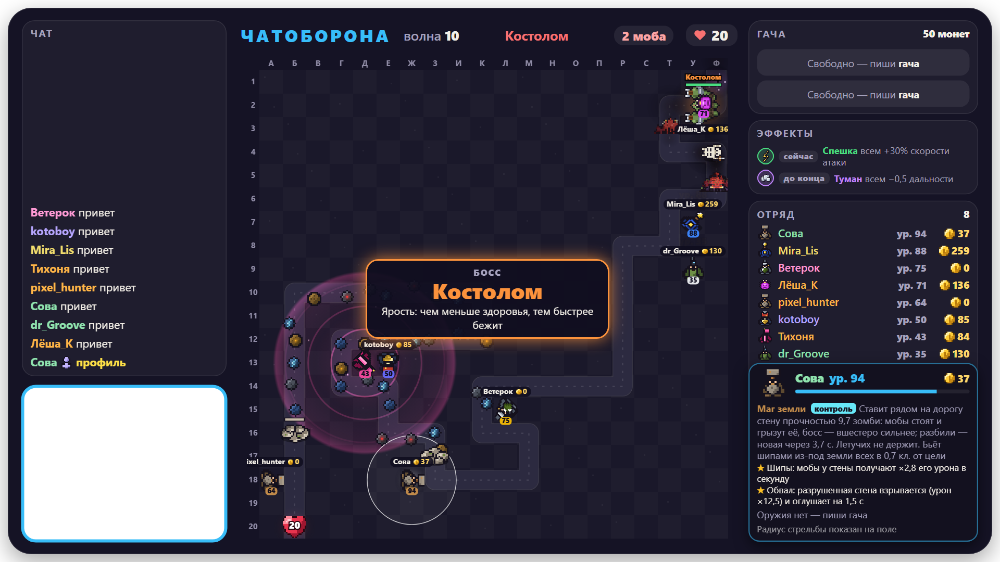
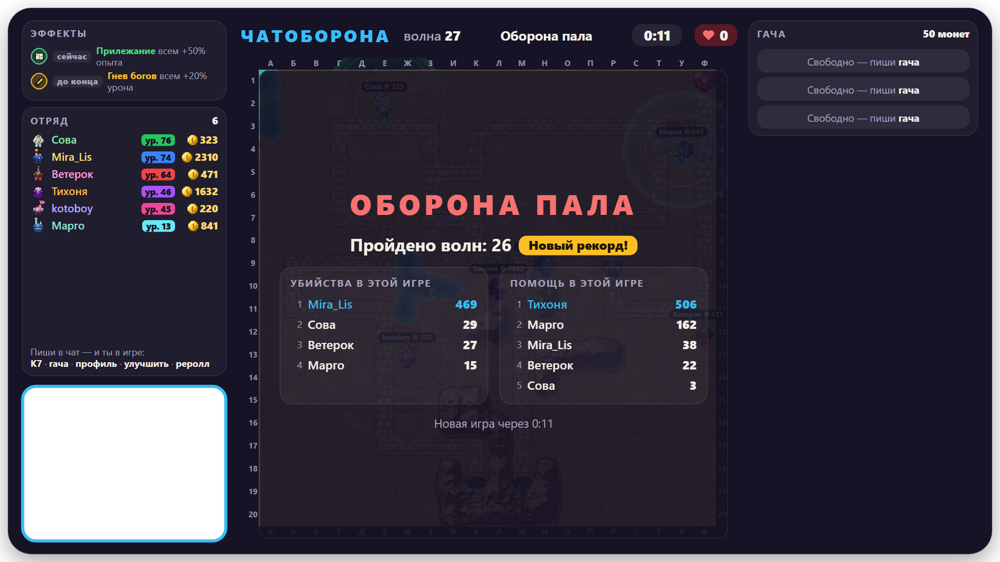
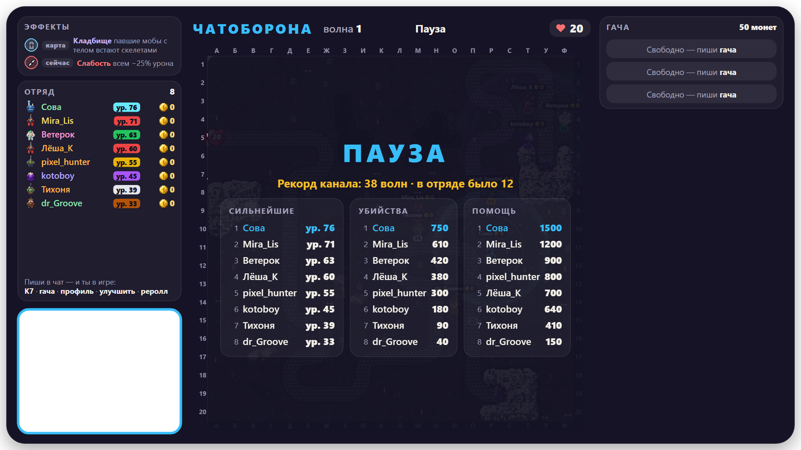

# Чатоборона

Игра для чата Twitch на русском языке. Зрители пишут в чат — и уже в отряде: получают случайный класс и вместе
защищают базу от волн мобов. Уровни копятся от игры к игре, монеты тратятся на гачу, а волны идут бесконечно —
пока база не падёт. Цель — новый рекорд канала.



**[gamesonstream.ru/chatoborona](https://gamesonstream.ru/chatoborona/)** — играй прямо в браузере или вставь
ссылку в OBS.

Ставить ничего не нужно: ни программ, ни регистрации, ни ключей Twitch. Зрителям тоже — они играют, просто
написав в чат.

## Как запустить



При каждом открытии страницы поверх игры появляется окно с правилами для стримера: как запустить, команды зрителей
и свои, как идёт игра. Закрывается крестиком или кнопкой «Закрыть», снова открывается кнопкой «Правила» в шапке.

**В браузере.** Открой [gamesonstream.ru/chatoborona](https://gamesonstream.ru/chatoborona/), впиши сверху свой
канал Twitch и нажми «Начать». Сразу начнётся набор в отряд. Пока игра не начата, на её месте пример с выдуманными
игроками.

Рядом с «Начать» — ещё четыре кнопки:

- **«Пауза»** замораживает игру. «Продолжить» возвращает её с того же места.
- **«Дальше»** не ждёт конца отсчёта: сразу карта или следующая волна.
- **«Заново»** заканчивает игру и собирает отряд заново. Уровни при этом не теряются.
- **«Сброс»** обнуляет уровни, счёт и рекорд канала.

«Заново» и «Сброс» нужно нажать дважды — чтобы не задеть случайно.

**В OBS.** На той же странице нажми «Ссылка для OBS», скопируй ссылку и вставь её в источник «Браузер»: ширина
1920, высота 1080. Игра начнётся сама, как только источник появится на экране.

Кнопка «Настройки» открывает панель рядом с игрой. Сохранять ничего не нужно: правки сразу действуют на игру в
браузере, а ссылка для OBS обновляется сама.

Что полезно знать про OBS:

- **Сцены.** Скрыл источник или ушёл на другую сцену — игра встала на паузу. Вернулся — игра продолжается с того же
  места. Если в свойствах источника отмечено «Отключать источник, когда он не виден», OBS выключает игру вместе с
  источником: после возвращения начнётся новая игра (уровни при этом сохраняются).
- **Вебка.** Окошко под вебку прозрачное: источник с камерой поставь в OBS под оверлей и подгони под рамку.
- **Звук** идёт из источника. Чтобы у игры была своя дорожка в микшере, включи в свойствах источника «Управление
  аудио через OBS».
- **Настройки зашиты в ссылку.** Поменял настройки — вставь в OBS новую ссылку.
- **Уровни хранятся в OBS.** Нужна игра в нескольких сценах — добавляй тот же источник («Добавить существующий»),
  а не новый.
- **Обновления.** Оверлей сам замечает, что игра обновилась, и перезагружается — только между играми.

## Как играть



1. **Набор в отряд.** Напиши в чат что угодно — и ты в отряде: получишь случайный класс. Не нравится — напиши
   `реролл`: выпадет другой, но только один раз за игру и только до первой волны. Пока идёт набор (3 минуты), на
   экране по очереди сменяются страницы: как играть, карта, кто в отряде, что умеет каждый класс, монеты и гача,
   уровни и роли, враги. Полоска под названием страницы показывает, когда она сменится.
2. **Подготовка.** Появляется карта 20×20: случайная местность и дорога из двух тоннелей (о ней — ниже). Каждый игрок — защитник на своей клетке: игра
   ставит всех в случайные клетки у дороги, а встать в другое место можно, написав клетку — букву столбца и номер
   строки, например `к7`. В подготовку защитник перебегает сразу, а во время волны — как только она кончится (до
   тех пор новая клетка обведена пунктиром). После перебежки защитник секунду не стреляет, а маг земли сразу
   ставит новую стену вместо старой.
3. **Волны.** Через минуту по дороге пойдут мобы. Защитники бьют их сами: команды для атаки не нужны. Между
   волнами — 20 секунд подготовки, а если волну отбили быстрее чем за 10 секунд после выхода последнего моба —
   всего 5: простые волны пролетают быстро. За каждую пройденную волну всем в отряде — монеты и опыт, и чем дальше волна,
   тем больше. Если волна затянулась, через две минуты после выхода последнего моба выжившие звереют: бегут
   быстрее, проходят сквозь стены, их не замедлить и не оглушить.
4. **Поражение.** Дошедший до базы моб секунду грызёт сердце, а потом отнимает жизни: обычный — одну, крепкий —
   две, элитный — три, босс — шесть. У базы 20 жизней. Когда они кончаются, на экране итоги игры, а через
   15 секунд — новый набор: новая карта, новые классы.

Вступить можно в любой момент, не только в наборе: защитник сразу появится на поле у дороги. После поражения
отряд собирается заново: чтобы снова играть, напиши в чат ещё раз.

## Карта

Карта каждый раз новая. Мобы выходят из **двух тоннелей** в горах у края поля — сразу из обоих, парами; примерно
посередине дороги два пути сливаются в один, и дальше мобы идут к сердцу вместе. На поле есть:

- **горы** — от пары скал до длинных хребтов, у подножия часто холмы. Встать на них нельзя, и они закрывают выстрел:
  моба за горой не достать. Иногда дорога проходит сквозь гору тоннелем — пока моб внутри, его не достать ничем,
  даже с вышки;
- **озёра и реки** (в вулкане — лавовые, на кладбище — чёрные, в снегах — подо льдом) — встать нельзя (в снегах на
  лёд — можно), но стрелять через них можно; где река пересекает дорогу, на дороге мост;
- **расщелины** — изредка, трещина в несколько клеток: встать нельзя, стрелять через неё можно; если она проходит
  под дорогой, на дороге мост;
- **руины** — изредка, развалины в две–четыре клетки: встать нельзя, и высокие стены закрывают выстрел, как гора;
- **кратеры** — одна–три воронки: встать нельзя, стрелять через них можно;
- **древности** — изредка одна на карту: на лугу, болоте и в снегах — круг камней, в пустыне и вулкане — кости
  великана, на кладбище — склеп. Встать нельзя; камни и склеп закрывают выстрел, кости — нет;
- **холмы** (в снегах — сугробы) — с них бьют на 0,8 клетки дальше;
- **вышки** — одна–три у самой дороги. На вышку встаёт один защитник: он бьёт на 2,5 клетки дальше (у ледяного
  мага и буря шире на столько же), а горы, руины и склепы ему не мешают — с вышки видно поверх них.

На земле — деревья, кусты, камни, кактусы, могилы и прочее под биом, а над полем своя жизнь: на лугу порхают бабочки,
на болоте мигают светлячки, в снегах идёт снег, в пустыне метёт песок, в вулкане летят искры, на кладбище плавают
огоньки; на воде блики, в лаве и болоте лопаются пузыри.

Карточка `профиль` рисует на поле, куда защитник достаёт на самом деле: горы вырезают из круга свою тень (у того,
кто на вышке, круг целый).

Местность — один из шести биомов:

| Биом | Что меняет |
| --- | --- |
| Луг | ничего — обычная карта |
| Вулкан | ледяные приёмы на четверть слабее: и урон, и замедление |
| Снега | огненные приёмы на четверть слабее; на льду озёр и рек можно стоять |
| Болото | ходячие мобы на 20% медленнее, но их на четверть больше |
| Пустыня | летучие мобы на 25% быстрее, и их на четверть больше |
| Кладбище | каждый павший моб с телом встаёт скелетом (крупный — скелетом-латником) с пятой частью здоровья; не встают бестелесные — элементали, слизни, призраки, миражи, голем, тень, мимик |

Какой биом выпал, игра объявляет, как только появляется карта, и до конца игры показывает в «Эффектах».

**Мобы** делятся на шесть видов, и **каждая волна — из одного вида**: обычные мобы, элитные и босс.

| Вид | С какой волны | Кто в нём |
| --- | --- | --- |
| Нежить | с 1-й | зомби, скелеты, призраки, костяные псы, скелеты-латники, руки мертвеца, летучие мыши; Чумной, Латник, Тень, Некромант, Вампир; Страж склепа, Банши, Король-лич |
| Звери | с 1-й | кабаны, кроты, гарпии, псы, вороны, медведи, крысы, летучие мыши; Вожак, Крысиный король, Броненосец; Крысиная матка, Медведь-шатун, Червь-пожиратель, Матка пауков |
| Орда | с 1-й | гоблины, орки, воришки, волчьи всадники, громилы, щитоносцы, тролли, гоблинята; Ведьма, Гоблин-шаман, Берсерк, Огр-носильщик; Костолом, Мясник, Вождь орды |
| Слизни | с 5-й | слизни всех размеров, попрыгунчики, крылатые, ледяные, грозовые и магмовые слизни; Слизень-король; Праматерь слизи, Слизень-исполин |
| Демоны | с 8-й | бесята, адские гончие, демоны, чертята; Огненный бес, Зеркальщик; Привратник ада, Архидемон |
| Стихии | с 16-й | огненные, ледяные, грозовые и ядовитые элементали, миражи, искры; Каменный голем, Прыгун; Владыка стихий, Дракон |

Орда берёт числом: в её волне мобов в 1,6 раза больше, но каждый слабее. Крылатые слизни летают, а стихийные слизни
не боятся своей стихии. Большой слизень, умирая, у всех на глазах делится на двух поменьше, а самые маленькие
растекаются лужицей.

Один и тот же вид два раза подряд не идёт. Какой вид будет следующим, видно вверху ещё в подготовку
(«Дальше — демоны»), а во время волны там написано «Волна демонов». Внутри вида новые мобы появляются со своей
волны, а пока их нет, вместо них выходит первый моб той же роли. Виды выровнены по силе: в среднем каждый
пропускает отряд примерно одинаково далеко. Вороны и летучие мыши летают: каменные
стены, мины, капканы, шипы, лужи яда и святая земля их не держат. Скелеты, костяные псы и скелеты-латники после смерти встают
ещё раз с полным здоровьем, а нежить яд не берёт. С 3-й волны в любой волне могут выйти элитные, иногда двое-трое
сразу, и чем дальше, тем чаще; на каждой десятой волне — босс. С каждой волной мобы крепче. Чем больше игроков,
тем крепче мобы — но медленнее, чем растёт отряд: большой отряд проходит дальше.

С каждым десятком волн мобы **закаляются**: оглушения, заморозка, сеть, замедления, отбрасывания и уязвимость
действуют на них слабее — на 7% после 10-й волны, на 30% после 50-й, примерно вдвое после 100-й, но никогда не
перестают действовать совсем. Сколько сейчас, видно в «Эффектах» («Закалка»).

Иногда сверх остальных выходит **мимик** — сундук на ножках. Он крепче элитного, зато за его убийство всем, кто
его бил, — золото, а в следующей волне монеты двойные. Пока его бьют, звенят монеты. Сердцу он не вредит: дойдя
до базы, зарывается в землю и пропадает.

С середины игры приходят **элементали** — их не берёт своя стихия: огненного (с 16-й волны) — огонь огнемётчика и
поджог, ледяного (с 18-й) — лёд, он не мёрзнет и не замедляется, грозового (с 22-й) — молнии, ядовитого
(с 25-й) — яд. И **слизни**: слизнёнок (с 5-й волны), слизень (с 12-й) при смерти делится на двух слизнят, большой
слизень (с 20-й) — на двух слизней, и так пока не умрут самые маленькие. Когда новый вид впервые выходит на поле,
на экране на 10 секунд появляется, что он умеет.

Ещё обычные мобы со своими повадками:

- **воришка** (с 7-й волны) крадёт по 3 монеты у каждого защитника, мимо которого бежит; кто его добьёт, заберёт
  всё украденное — над вором виден мешочек;
- **крот** (с 9-й) раз в 5 секунд зарывается на полторы: под землёй его не достать, мины не рвутся, под каменной
  стеной он проходит;
- **призрак** (с 13-й, нежить) раз в 4 секунды на секунду становится бесплотным: проходит сквозь стены и мины, урон
  по нему вдвое слабее;
- **щитоносец** (с 15-й, крепкий) держит щит перед собой: защитники, стоящие впереди него по дороге, бьют на 60%
  слабее — бить его лучше сбоку и сзади;
- **гарпия** (с 19-й) летает и раз в 8 секунд оглушает ближайшего защитника на секунду;
- **мираж** (с 24-й) от первого удара распадается на трёх одинаковых: настоящий один, копии умирают от любого
  удара, ничего не дают и сердцу не вредят.

**События.** Перед каждой волной может выпасть событие на всех — оно видно справа, в «Эффектах», ещё в
подготовку:

- **бафф** (в 35% случаев) на одну волну: больше урона, скорости атаки, дальности, шанса крита, монет или опыта;
- **дебафф** (30%) на одну волну: меньше урона, скорости или дальности, а то и сон в первые 5 секунд;
- **благословение** (2%) до конца игры: больше урона или монет, мобы медленнее, база получает жизни;
- **проклятие** (2%) до конца игры: мобы крепче или быстрее, база теряет жизни, меньше дальности;
- в остальных случаях волна идёт без события.

У элитных и боссов есть навыки. Когда выходит босс — каждый раз, а элитный — когда этот вид впервые встречается за
игру, на 10 секунд появляется его имя и что он умеет. Над головой у них имя и полоска здоровья; боссы обведены
красным, элитные — золотом.

**Серебряные элитные.** С 4-й волны любой обычный моб может выйти серебряным: в 2,5 раза крепче, с серебряной
обводкой, с подписью свойства и полоской здоровья над головой. За него втрое больше опыта и вдвое больше монет.
Шанс растёт с волнами: 4% на 4-й, около 10% к 30-й, не больше 15%. Когда свойство выходит впервые за игру, на экране
появляется, что оно делает. Серебряных, как и золотых, первыми бьют и метят охотник (и его «Добыча»), «Наповал»
снайпера, РПГ подрывника и «Слабое место» мудреца — сразу после боссов и золотых элитных.

| Свойство | Что делает |
| --- | --- |
| Быстрый | бегает на 40% быстрее |
| Живучий | вдвое крепче |
| Бронированный | получает на 30% меньше урона |
| Огнеупорный, Морозостойкий, Заземлённый, Ядоустойчивый | не боится огня, льда, молний или яда |
| Живой | постоянно восстанавливает здоровье |
| Неудержимый | не замедляется, не оглушается, не отбрасывается и получает на 20% меньше урона |
| Яростный | чем меньше здоровья, тем быстрее бежит |
| Кровосос | лечится, когда рядом гибнут мобы |
| Прыгучий | раз в 6 секунд прыгает на 2,5 клетки вперёд |
| Щитоносный | раз в 8 секунд неуязвим на 2 секунды |
| Невидимка | раз в 6 секунд на 2 секунды пропадает из прицелов |
| Рывок | временами бежит вдвое быстрее |
| Оберегающий | раз в 10 секунд даёт мобам вокруг щит на 10% их здоровья |
| Взрывной | умирая, взрывается и оглушает защитников рядом на 1,5 секунды |
| Делящийся | умирая, распадается на двух обычных |



| Кто | Навык |
| --- | --- |
| Вожак (элитный) | Рывок — временами бежит вдвое быстрее |
| Чумной (элитный) | Лечение — лечит мобов на 4 клетки вокруг себя |
| Латник (элитный) | Броня — получает на 35% меньше урона |
| Крысиный король (элитный) | Выводок — призывает крыс |
| Тень (элитный, с 6-й волны) | Невидимость — раз в 6 секунд на 2 секунды пропадает из прицелов |
| Прыгун (элитный, с 8-й волны) | Скачок — раз в 6 секунд прыгает на 2,5 клетки вперёд |
| Некромант (элитный, с 9-й волны) | Поднять мёртвых — раз в 7 секунд поднимает двух скелетов |
| Ведьма (элитный, с 10-й волны) | Сглаз — раз в 6 секунд оглушает ближайшего защитника на 1,5 секунды |
| Берсерк (элитный, с 12-й волны) | Неистовство — раз в 8 секунд на 3 секунды несётся почти вдвое быстрее, и его не остановить |
| Каменный голем (элитный, с 14-й волны) | Каменная кожа — не замедляется, не оглушается, не отбрасывается и получает на 20% меньше урона |
| Огненный бес (элитный, с 15-й волны) | Адский жар — мобы рядом бегут на 30% быстрее |
| Вампир (элитный, с 18-й волны) | Кровосос — лечится, когда рядом гибнут мобы |
| Гоблин-шаман (элитный, с 11-й волны) | Оберег — раз в 10 секунд даёт мобам вокруг щит на 10% их здоровья |
| Огр-носильщик (элитный, с 20-й волны) | Носильщик — несёт трёх гоблинов: теряя здоровье, роняет их по одному, умирая — всех |
| Зеркальщик (элитный, с 28-й волны) | Зеркало — раз в 6 секунд поднимает зеркало: удар отражается, стрелявший оглушён на 1,5 секунды |
| Броненосец (элитный, с 33-й волны) | Клубок — от сильного удара сворачивается: 2 секунды неуязвим и катится вдвое быстрее |
| Слизень-король (элитный, с 30-й волны) | Деление — при смерти распадается на двух больших слизней |
| Мимик (сверх остальных, с 3-й волны) | Сокровище — за убийство золото всем, кто бил, и двойные монеты в следующей волне |
| Мясник (босс) | Регенерация — постоянно восстанавливает здоровье; Хук — раз в 10 секунд закидывает крюк на цепи в случайного защитника (крюк летит пару секунд) и за пару секунд подтягивает его на свободную клетку рядом с собой |
| Костолом (босс) | Ярость — чем меньше здоровья, тем быстрее бежит |
| Крысиная матка (босс) | Орда — призывает стаи крыс |
| Праматерь слизи (босс) | Слизь — раз в 7 секунд выпускает двух слизнят, а при смерти распадается на двух слизней |
| Привратник ада (босс) | Врата ада — раз в 9 секунд открывает врата: выбегают две адские гончие |
| Владыка стихий (босс) | Смена стихии — раз в 6 секунд меняет стихию (огонь, лёд, молния, яд) и не боится той, что сейчас |
| Банши (летучий босс, с 20-й волны) | Вопль — раз в 8 секунд кричит: защитники на 3 клетки вокруг оглушены на секунду |
| Медведь-шатун (босс, с 20-й волны) | Рёв — раз в 8 секунд ревёт: звери на 3 клетки вокруг 3 секунды бегут на 40% быстрее |
| Слизень-исполин (босс, с 30-й волны) | Кровосос — лечится, когда рядом гибнут мобы; при смерти распадается на двух больших слизней |
| Вождь орды (босс, с 30-й волны) | Боевые барабаны — раз в 8 секунд созывает четырёх гоблинов |
| Страж склепа (босс) | Щит — раз в 8 секунд неуязвим на 2 секунды |
| Архидемон (босс, с 20-й волны) | Призыв бесов — призывает бесят |
| Король-лич (босс, с 30-й волны) | Бессмертие — после смерти встаёт с полным здоровьем и поднимает трёх скелетов |
| Червь-пожиратель (босс, с 40-й волны) | Подкоп — ползёт под землёй и выныривает раз в 6 секунд на 2 — только тогда его можно бить; вынырнув, глотает мины, капканы и лужи; дойдя до сердца, отнимает 10 жизней |
| Дракон (летучий босс, с 50-й волны) | Огненное дыхание — раз в 10 секунд дышит огнём по прямой: защитники на линии оглушены на 2 секунды, мины и лужи сгорают; огонь его жжёт вдвое слабее |
| Матка пауков (босс, с 60-й волны) | Паутина — раз в 7 секунд опутывает защитника, и тот 5 секунд бьёт вдвое медленнее; при смерти выпускает восемь паучат |

## Уровни

За каждого моба, в убийстве которого ты участвовал, — ударил, поджёг, отравил, заморозил, поймал в капкан или
ускорил того, кто ударил, — начисляется опыт: за обычного 1, за крепкого 2, за элитного 5, за босса 20. Добившему
засчитывается убийство, остальным — помощь. За каждую пройденную волну всем в отряде ещё и опыт: 1 за первую и на
0,1 больше за каждую следующую, — и монеты: 4 и ещё по 0,6 за номер волны (за 10-ю — 10, за 50-ю — 34).
Сверху каждый получает доход — 10% от монет, которые были у него до награды (вниз до целой монеты): у кого 300
монет, тому ещё 30. Чтобы все классы прокачивались примерно одинаково, у каждого свой множитель опыта
и монет за моба: кто задевает много мобов сразу (громовержец, ледяной маг, минёр), получает за каждого чуть
меньше, кто бьёт по одному — чуть больше.

Уровней 100, каждый следующий дороже предыдущего. Сила героя от уровня не растёт: урон, скорость и всё остальное
у игрока 1-го и 100-го уровня одинаковые. Уровень открывает способности класса: на **10-м** — первую (работает
всегда), на **30-м** — вторую (срабатывает с шансом), на **50-м** — третью (сама, раз в несколько секунд).
Сильнее героя делают оружие из гачи, руны и парагон.

Уровни, убийства и помощь хранятся между играми. Обнулить их можно кнопкой «Сброс», командой или по расписанию.

Примерно так растёт игрок, который играет без перерывов в отряде человек из десяти: 10-й уровень — за первый час,
30-й — часа за три, 50-й — часов за девять, 100-й — за тридцать.

Кто дошёл до 100-го уровня, тому игра устраивает праздник: посреди карты поздравление с его героем и ником, сыплется
конфетти. Уровень у него везде показан числом «100», как у всех.

### Парагон

Сотый уровень — не конец. Игрок 100-го уровня получает **парагон**, если к концу игры у него есть сразу:

1. божественное оружие (см. «Гача»);
2. частица бога — она выпадает в гаче.

Тогда перед итогами посреди поля — церемония: частица бога влетает в героя, вспышки, плашка «ур. 100» дрожит и
становится «ур. 1», сверху опускается золотой флаг с номером парагона (второй, третий — цифра на флаге меняется), с
ником игрока, и сыплется конфетти. Через 16 секунд — итоги, как обычно. Уровень снова первый, частица сгорает: для
следующего парагона её надо выбить заново. Каждый парагон прибавляет 5% к мощи героя. Флаг с номером стоит перед
уровнем везде, кроме поля: в отряде, в
карточке, в списке набора и в «Сильнейших». Парагон хранится вместе с уровнями, сбрасывается вместе с ними.

## Классы

Класс выпадает случайно в каждой новой игре; у нескольких игроков может оказаться один и тот же класс. Точные
числа своего класса — урон, проценты, дальность, когда откроются способности — показывает карточка `профиль`.

**Мощь.** Сила героя — одно число, мощь. Без оружия она 100, оружие прибавляет свою мощь (в гаче рядом с оружием
красный значок с мечом и число), каждый парагон — ещё 5%. Во сколько раз мощь больше 100, во столько раз сильнее
обычные удары и урон способностей: мощь 150 — в полтора раза сильнее, чем без оружия. Баффы знаменосца, лекаря и
мудреца от мощи тоже растут, но мягче. А скорость атаки, крит, дальность, перезарядка и длительность способностей у
каждого класса свои и от оружия не зависят. Мощь видна в карточке `профиль`; там же, вверху рядом с клеткой, — меч и
щит: сколько у игрока убийств и сколько помощи в этой игре.

Знаменосец, лекарь и мудрец — поддержка: сами бьют слабо, зато усиливают отряд. Одинаковые ауры не складываются:
два знаменосца рядом дают одно знамя. За моба, которого убил союзник под их баффом, им засчитывается помощь.
Знаменосцев и мудрецов выпадает не больше одного на каждые 10 игроков (в отряде до 10 человек — по одному, из 11–20 —
до двух); лекарь и сам неплохо бьёт, лекарей может быть сколько угодно.

Числа урона ниже — для мощи 100; с оружием они растут во столько же раз.

| Класс | Как воюет | 10-й уровень | 30-й уровень | 50-й уровень |
| --- | --- | --- | --- | --- |
| Снайпер | Бьёт на 5 клеток — дальше всех: сперва по летучим, потом по самому крепкому. Стреляет редко, но сильно: урон ×2,6 | **Сквозная пуля** — пуля прошивает всех на линии с одинаковым уроном, а за каждого задетого урон выстрела растёт на 10% | **Заряженная пуля** — с шансом 16% секунду заряжает пулю и стреляет толстой и яркой: урон ещё ×6, всегда крит | **Наповал** — раз в 16,3 с три секунды целится в одного моба — сперва в босса или элитного — и бьёт: урон ещё ×24, всегда крит, не прошивает. Метка висит 6,1 с: цель получает +25% урона от всех |
| Пулемётчик | Очень часто стреляет на 3 клетки — по всем подряд, боссов не выделяет. Держит одну цель и разгоняется на ней до +100% скорости; после 7 с стрельбы — 3 с перезарядки | **Перегрев** — после 3 с стрельбы ствол раскаляется: каждая пуля ещё жжёт огнём, урон ×1,8 | **Рикошет** — с шансом 30% пуля отскакивает в моба рядом с целью: 62% урона, огонь тоже | **Берсерк** — после 5 с стрельбы на 2 с — предельная скорость, +86% урона и +61% к силе крита |
| Подрывник | Стреляет на 3 клетки: снаряд взрывается и бьёт всех на 1 клетку вокруг одинаково, урон ×1,2 | **Горящая земля** — после взрыва земля горит 3,7 с и жжёт: урон ×2,1 в секунду; летучих не жжёт | **Детонация** — с шансом 37% через 0,3 с взрыв повторяется — и повтор может повториться, каждый раз вдвое реже | **РПГ** — раз в 20,4 с две секунды заряжает ракету и бьёт в ближайшего босса или элитного: всем на 2 клетки вокруг урон ×36 и оглушение на 1,8 с |
| Громовержец | Молния бьёт цель на 3,5 клетки и перескакивает назад по дороге ещё до 9 мобов, каждому следующему на 10% меньше; урон ×0,9 | **Заряд** — задетые молнией заряжены: получают +18% урона от всех, пока молния бьёт их хотя бы раз в 5 с | **Вспышка** — с шансом 18% удар молнии разряжается вспышкой: всем на 1 клетку вокруг тот же урон | **Удар грома** — раз в 12,2 с бьёт молнией в первого моба на дороге, где бы он ни был: критический урон ×12 ему и всем на 1 клетку вокруг, оглушение на 1,8 с |
| Алхимик | Кидает ядовитые зелья на 3,5 клетки: урон ядом ×2,1. Летучих не бьёт, нежить яд не берёт | **Ядовитая лужа** — зелье оставляет лужу на 4,9 с: кто в ней, травится, урон ядом ×1,8 в секунду; летучих не травит | **Отрава** — с шансом 37% яд въедается: ещё 6,1 с, урон ×0,9 в секунду | **Ядовитый туман** — раз в 16,3 с кидает гранату: туман на 1,8 клетки вокруг на 5 с глушит все навыки мобов и травит, урон ×2,4 в секунду |
| Огнемётчик | Без остановки жжёт узкой струёй огня на 2,5 клетки, сперва мелочь; нежить горит в 1,5 раза сильнее | **Горение** — задетый огнём горит ещё 3,7 с, теряя в секунду ×12 урона струи | **Вспыхнуть** — горящий с шансом 16% в секунду вспыхивает: урон ×18 ему и огненному кольцу на 1,2 клетки вокруг | **Нефть** — раз в 16,3 с разливает нефть на дорогу рядом с собой; от огня она горит 3,7 с и жжёт всех в ней на ×27 урона струи в секунду |
| Охотник | Из арбалета на 3,5 клетки слабо бьёт всех, а элитных и боссов — первыми и с уроном ×5 | **Капканы** — ставит до 3 капканов в своём радиусе: попавший стоит 1,8 с и получает +61% урона | **Сеть** — с шансом 18% набрасывает сеть: моб — даже босс — стоит 2 с и получает +49% урона | **Добыча** — раз в 24,5 с метит ближайшего босса или элитного на 12,3 с: все бьют его первым. Убьют за 10 с — охотнику 49 монет, остальным вдвое меньше |
| Паразит | Первые 10 волн — личинка в коконе на клетке: не бьёт, зато каждую волну получает от 1 до 200 монет. Потом цепляется к самому крепкому мобу и грызёт его, убил — прыгает на следующего | **Шок** — крит оглушает на 0,6 с и отнимает ещё 10% здоровья (у элитных 5%, у боссов 3%), но не больше урона ×25 | **Пир** — добив моба, с шансом 43% получает на 123% больше опыта и монет | **Налёт** — раз в минуту прыгает на голову союзнику, у которого больше 1000 монет, и забирает все его монеты себе; потом 10 с спит у него на голове, а союзник спит 60 с. Когда у самого паразита больше 1000 монет, он раздаёт все свои монеты случайно всем, себе тоже |
| Минёр | Не стреляет: раз в 3 с ставит мину на дорогу в 2 клетки от себя, до 10 сразу. Мина рвётся под мобом, урон ×2,5; летучих мины не задевают | **Граната** — раз в 4,9 с кидает гранату в случайного моба на поле: урон ×4,6 | **Усиленная мина** — с шансом 18% вместо обычной ставит усиленную в 10 клетках от себя (до 5 сразу, а когда обычных полный запас — всегда): урон ×15,2 | **Ядерка** — раз в 2 минуты, если моб ближе 5 клеток, запускает в него ядерку: она убивает его и всех мобов на 2 клетки вокруг, а слишком крепким наносит урон ×200 |
| Ледяной маг | Вокруг него ледяная буря на 2,7 клетки: раз в секунду бьёт льдом всех в ней, урон ×0,6 | **Стужа** — в буре мобы медленнее на 43%, а вышедшие ещё 3,7 с идут подмороженными | **Заморозка** — с шансом 12% удар льдом замораживает на 1,8 с | **Снегопад** — раз в 24,5 с снег на всё поле: все мобы 3,7 с подморожены, а с шансом 23% — заморожены |
| Шаман ветра | Пускает по дороге вихри на 3 клетки: вихрь катится назад и бьёт всех на пути сквозь броню, урон ×1,9 | **Порыв** — с шансом 30% вихрь стягивает обычных мобов на 1 клетку вокруг и отбрасывает их на клетку назад | **Отброс** — с шансом 15% удар отбрасывает задетых на 1,2 клетки | **Пронзающий ветер** — раз в 20,4 с ветер на 3,1 клетки вокруг: союзники 7,4 с бьют на 49% быстрее, сам он — на 98% |
| Маг земли | На 3 клетки бьёт шипами из-под земли — сразу две клетки дороги, урон ×1 | **Каменная стена** — ставит на ближайшую клетку дороги стену прочностью 2,9 зомби: мобы стоят и грызут её, боссы — сильнее | **Шипастая стена** — грызущий стену с шансом 50% в секунду получает урон ×6 | **Метеорит** — раз в 28,6 с на дорогу падает метеорит: всем на 2,5 клетки вокруг урон ×26 землёй и огнём и оглушение на 10 с |
| Знаменосец | Бьёт древком на 1,5 клетки, урон ×1. Над ним знамя на 3,2 клетки: все под знаменем, и он сам, бьют на 35% быстрее и на 20% дальше | **Боевой клич** — раз в 8,2 с все под знаменем 4,9 с бьют на 61% сильнее | **Натиск** — с шансом 16% удар союзника под знаменем — критический | **Знамя победы** — раз в 28,6 с поднимает знамя над полем: весь отряд 9,8 с бьёт на 49% быстрее |
| Лекарь | Бьёт святым светом на 3 клетки, урон ×0,9, по нежити в 2,5 раза сильнее, и убитая им нежить больше не встаёт. После волны возвращает сердцу 1 жизнь (все лекари вместе — не больше 2), каменные стены рядом чинит | **Щит** — с шансом 23% дошедший до сердца моб не отнимает жизнь; боссы отнимают всегда | **Очищение** — раз в 12,2 с союзники на 3,2 клетки вокруг стряхивают оглушение, сглаз, паутину и сон и 4,9 с ничего не боятся | **Святая земля** — раз в 24,5 с освящает дорогу на 2,2 клетки вокруг там, где мобов больше всего: 9,8 с нежить на ней горит — урон ×3 в секунду, — а все мобы получают на 49% больше урона |
| Мудрец | Пускает из книги искры сразу в 2 мобов на 3 клетки, урон ×0,8 каждой. Все на 3,2 клетки вокруг, и он сам, получают +25% опыта | **Вдохновение** — раз в 4,9 с выбирает союзника рядом — тот 8,6 с бьёт на 61% сильнее и быстрее | **Озарение** — с шансом 30% вдохновлённый сразу перезаряжает свою способность — ракету, метеорит, удар молнии и другие | **Слабое место** — раз в 18 с метит самого сильного моба — сперва босса или элитного: 9,8 с весь урон по нему на 86% больше, а за его убийство каждый, кто его бил, получает вдвое больше опыта |

Одного и того же моба нельзя отбрасывать бесконечно, а оглушить снова можно только через секунду после прошлого
оглушения. Сеть охотника держит и боссов, но голема не останавливает ничто. Паразит первые 10 волн — кокон на своей
клетке, переставить его нельзя; вылупившись, он клетку освобождает и ездит на мобах.

**Руны способностей.** У каждого класса две руны. Руна выпадает в гаче (1,5%), можно собрать обе — действуют вместе.
Когда собраны обе, руна больше не выпадает. Руны, как и оружие, — на одну игру и пропадают после реролла. Если руна
усиливает способность, которая ещё не открыта, она заработает, когда способность откроется.

| Класс | Первая руна | Вторая руна |
| --- | --- | --- |
| Снайпер | **Двойной выстрел** — обычная атака стреляет сразу в двух мобов | **Разрывная пуля** — с шансом 5% пуля разрывается: всем на клетку вокруг 25% её урона |
| Пулемётчик | **Бесконечный барабан** — перезарядка не нужна: строчит без остановки | **Плазменные пули** — огненные пули пробивают броню и любые щиты |
| Подрывник | **Напалм** — огонь растекается дальше: горящая земля вдвое шире | **Кассетный выстрел** — стреляет сразу двумя снарядами в разные цели |
| Громовержец | **Цепная молния** — молния не слабеет, перескакивает ещё на 5 мобов и может идти в обе стороны | **Разрядка** — заряженный, по которому молния не била 5 с, разряжается: огромный урон и оглушение на 5 с |
| Алхимик | **Инфекция** — отравленные гниют ещё 5 с после яда: теряют 1% здоровья в секунду (боссы — 0,3%), но не больше урона ×0,6 в секунду | **Чума** — яд чернеет: берёт и нежить, пробивает броню и бьёт на 25% сильнее |
| Огнемётчик | **Широкое сопло** — струя огня вдвое шире | **Синее пламя** — огонь синеет: урон и горение вдвое сильнее |
| Охотник | **Засада** — никого не бьёт 10 с — прыгает к первому мобу на дороге | **Мастер ловушек** — капканов вдвое больше, капканы и сеть действуют вдвое сильнее |
| Паразит | **Бешенство** — кусает втрое чаще | **Смертельный шип** — с шансом 3% добивает моба, у которого меньше 30% здоровья; слишком крепкому наносит урон ×40 |
| Минёр | **Ядерный синтез** — граната иногда оказывается маленькой ядеркой: огромный урон на 2 клетки вокруг и оглушение на 10 с всем рядом, и мобам, и защитникам | **Большой запас** — все запасы мин вдвое больше |
| Ледяной маг | **Вечная мерзлота** — подморозка и заморозка вдвое дольше | **Хрупкость** — замороженный моб с шансом 0,5% гибнет от любого удара; слишком крепкий получает урон ×40 |
| Шаман ветра | **Торнадо** — вихри становятся торнадо: впитывают огонь, яд, лёд и молнию по пути — с земли, из бури и с задетых мобов — и бьют всеми стихиями | **Встречный ветер** — все мобы на поле на 20% медленнее |
| Маг земли | **Стальная стена** — стена из стали, втрое прочнее | **Каменные шипы** — шипы бьют сразу на пять клеток |
| Знаменосец | **Багровый стяг** — во время боевого клича союзники ещё и бьют на 20% быстрее | **Знамя в землю** — «Знамя победы» держится на 3 секунды дольше и отбрасывает мобов вокруг знаменосца на клетку |
| Лекарь | **Ангел-хранитель** — «Щит» спасает и от боссов | **Второй шанс** — раз за игру, когда у сердца кончаются жизни, лекарь возвращает 5 — один раз на весь отряд |
| Мудрец | **Ученик** — вдохновение достаётся сразу двоим | **Всеведение** — «Слабое место» метит трёх самых сильных |

## Монеты и гача

За убийство моба дают 3 монеты, за помощь — 2 (за элитных — втрое больше, за боссов — вдесятеро). Монеты видно
рядом с ником над защитником на поле и в списке отряда слева. Монеты живут одну игру.

`гача` — крутка за 50 монет (можно и `!гача`). Справа три карусели: крутят трое сразу, остальные ждут очереди.
Писать `гача` можно несколько раз подряд, пока хватает монет: монеты списываются сразу, крутки встают в очередь,
и если места свободны, один игрок займёт их все. В очереди у одного игрока может быть не больше 5 круток: на
шестую игра ответит «твои крутки ещё в очереди», монеты не спишутся. Освободившееся место сначала достаётся тому,
кто сейчас не крутит. Когда в очереди 12 круток и больше, карусели крутятся и показывают выпавшее быстрее, а
когда больше 30 — появляется четвёртая карусель, больше 100 — пятая; очередь спадёт — лишние уйдут. Под каруселями видно, кто ждёт и сколько круток: «Аня ×3». Карусель — лента ячеек: она бежит слева
направо, замедляется и останавливается на выпавшем, редкость видна по цвету рамки. Выпавшее висит 7 секунд
(4 — если ждут другие).

Из гачи выпадает оружие под твой класс — или пустота, или монеты (горстка, мешок или сундук), или, очень редко,
руна способности или частица бога:

| Что выпало | Цвет | Шанс | Что даёт |
| --- | --- | --- | --- |
| Пустота | серый | 13,3% | ничего |
| Горстка монет | жёлтый | 7,5% | от 1 до 50 монет |
| Мешок монет | янтарный | 6,75% | от 51 до 150 монет |
| Сундук монет | золотой | 0,75% | от 151 до 500 монет |
| Руна способности | красный | 1,5% | одна из двух рун твоего класса, которой у тебя ещё нет |
| Частица бога | красный | 0,2% | остаётся навсегда (между играми тоже), нужна для парагона; у кого она есть, тому не выпадает |
| Обычное оружие | зелёный | 27% | мощь около 4 |
| Редкое | синий | 20% | мощь около 8 |
| Мифическое | фиолетовый | 10% | мощь около 17 |
| Эпическое | жёлтый | 7% | мощь около 27 |
| Легендарное | оранжевый | 6% | мощь около 40 и одно особое свойство |

Оружие у каждого класса своё: снайперу карабин, пулемётчику пулемёт, подрывнику гранатомёт, громовержцу посох,
алхимику флакон, огнемётчику огнемёт, охотнику арбалет, паразиту шип, минёру детонатор, ледяному магу жезл, шаману
тотем, магу земли каменная рука. У оружия одно число — мощь, она прибавляется к мощи героя; у оружия одной
редкости мощь чуть разная (±20%). У легендарного (и выросшего из него божественного) есть ещё одно свойство из
пяти: **скорострельность** — атака на 15% чаще, **дальнобойность** — +0,5 клетки дальности (паразиту не
выпадает), **меткость** — +10% шанса крита, **быстрота** — способности на 15% чаще, **щедрость** — +15% монет.

Выбирать ничего не нужно: если выпавшее оружие реже твоего — оно надевается само; той же редкости — если его мощь
больше (с улучшениями твоего); иначе остаётся твоё. Когда оружия ещё нет, надевается любое. Оружие действует только на хозяина и только до конца
игры: в новой игре оружия нет, и гачу крутят заново.

`улучшить` — за 100 монет +6 мощи твоему оружию; `улучшить 5` — пять раз, `улучшить все` — на все монеты. Сколько
раз оружие улучшали, видно рядом с названием («Легендарный карабин +12»). Улучшать можно сколько угодно раз.

**Божественное оружие.** Легендарное оружие на +30 становится божественным (красным): мощь со всеми улучшениями
остаётся, счёт улучшений начинается снова с +1, и каждое следующее улучшение прибавляет 3% мощи. Когда оружие
становится божественным, посреди поля на 10 секунд выходит объявление с ником игрока и мощью нового оружия. Плашка уровня у него становится красной.

`профиль` — твоя карточка справа: висит, пока её не сменит карточка другого игрока (но не меньше 10 секунд); ник и монеты (если выбита частица бога — она слева от монет),
под ними уровень, клетка, где ты стоишь, и радиус
атаки, дальше класс, мощь, три способности с точными числами (ещё не открытые — с уровнем, на котором
откроются), руны, оружие и его мощь. Пока карточка на экране, твой ник на поле мигает красным, а вокруг защитника обведено, куда он
достаёт: круг дальности, из которого горы вырезают свою тень. `проф` — та же карточка, только без описания
класса. Если есть место, справа видны две карточки сразу; остальные ждут очереди и сменяют старшую, когда та
провисит хотя бы 10 секунд.

## Команды в чате

Для всех:

```
что угодно            вступить в отряд — подойдёт любое сообщение
к7                    встать на клетку (буква столбца и номер строки); во время волны — после неё
гача                  крутить гачу за 50 монет; «гача 3» — три крутки, «гача все» — на все монеты
                      (не больше пяти за раз); докупленные встают в конец очереди
улучшить              +6 мощи оружию за 100 монет; «улучшить 5» — пять раз, «улучшить все» — на все монеты
профиль               своя карточка на экране
проф                  то же, но без описания класса
реролл                другой случайный класс — один раз за игру и только до первой волны
```

Для стримера и модераторов:

```
!чатоборона           правила игры на экране, игра на паузе (продолжить — !чатоборона-пауза)
!чатоборона-пауза     поставить игру на паузу; ещё раз — продолжить
!чатоборона-дальше    не ждать: сразу карта или следующая волна; после 100-й волны — играть дальше
ускорить              игра быстрее: ×2, ещё раз — ×3 (можно и !чатоборона-ускорить)
замедлить             обратно: ×3 → ×2 → ×1 (можно и !чатоборона-замедлить)
!чатоборона-заново    новая игра
!чатоборона-сброс     обнулить уровни, счёт и рекорд
```

Только хозяин канала: `а1 б2` — переставить защитника с клетки А1 на клетку Б2 (во время волны — после неё);
`@ник профиль` — открыть карточку игрока (`@ник проф` — короткую).

**Победа.** Каждая сотая волна (100-я, 200-я…) — победа: посреди поля на минуту выходит «Победа! Вы прошли 100
волн», а потом игра заканчивается итогами. Если стример или модератор за эту минуту напишет `!чатоборона-дальше`,
отряд играет ещё сто волн.

**Скорость.** `ускорить` и `замедлить` меняют скорость всей игры от ×1 до ×3; скорость видна рядом с тем, что
происходит, вверху экрана, и остаётся, пока её не сменят. В браузере то же делает кнопка «×1» сверху.

## Настройки

| Настройка | По умолчанию | Что делает |
| --- | --- | --- |
| Канал Twitch | — | Чей чат читать: логин или ссылка на канал |
| Набор в отряд | 180 с | Сколько длится набор перед каждой игрой |
| До первой волны | 60 с | Сколько длится подготовка от появления карты до первой волны |
| Подготовка | 20 с | Пауза между волнами |
| Команды для стримера и модераторов | включены | `!чатоборона-пауза`, `-дальше`, `-заново`, `-сброс` |
| Обнулять уровни и рекорд | только вручную | Или сами: каждый день, неделю, месяц — в заданный час — либо по таймеру |
| Звуки и громкость | включены, 100% | Выстрелы, попадания и приёмы каждого класса, волна, босс, уровень, гача, прорыв, поражение |
| С вебкой / без вебки | с вебкой | Без вебки место окошка занимают эффекты и отряд |
| Скрыть отряд и эффекты | нет | Убирает левую панель целиком: эффекты, отряд и окошко под вебку |
| Убрать гачу и профили | нет | Убирает правую панель |
| Прозрачный фон | нет | Без тёмной подложки — если под игрой свой фон |

Значения по умолчанию — рекомендуемые: с ними страница открывается в первый раз, к ним же возвращает кнопка
«Рекомендуемые настройки».

## Что на экране



- **Поле** — 20×20 клеток с подписями: буквы сверху и снизу, номера слева и справа. Земля, дорога, горы, озёра и
  холмы, расщелины, руины и кратеры нарисованы под биом. Мобы выходят из двух тоннелей, база —
  бьющееся пиксельное сердце с числом жизней (когда жизней мало, бьётся чаще). Вокруг ледяного мага кружит
  ледяная буря, от знаменосца расходятся розовые волны, у мудреца — фиолетовый купол с огоньками по краю,
  ускоренных шаманом союзников окружает ветер, паразит первые волны лежит коконом. Ауры и эффекты обрезаются по краю
  поля. Защитники и мобы — пиксельные, вид сверху: защитник
  поворачивается к цели и вздрагивает от выстрела, у каждого класса свои снаряды и свои эффекты. По мобам видно,
  что с ними: замедленный синеет и оставляет ледяной след, отравленный зеленеет, горящий краснеет и полыхает,
  замороженный стоит в глыбе льда, оглушённый — со звёздочками, заряженный молнией искрит, пойманный в сеть стоит
  в сетке, добыча охотника — под красной стрелкой, меченый снайпером — в прицеле. Моб, по которому попали, на миг вспыхивает
  белым — урон видно, даже когда у моба нет полоски здоровья. Убитый моб рассыпается в кучку, лежит
  секунду и медленно тает. Под защитником — уровень на плашке цвета редкости его оружия (без оружия — белой),
  над ним — ник и монеты. Если подписи налезают друг на друга, видны те, кто только что
  что-то сделал.
- **Сверху** — номер волны, что происходит, отсчёт или сколько мобов осталось, жизни базы; когда игра ускорена —
  яркая плашка «×2» или «×3».
- **Слева** — эффекты (биом карты, что действует сейчас, что в следующей волне, что до конца игры) и отряд — все, кто
  сейчас в игре, с классом, уровнем и монетами; когда не помещаются в столбик, встают в два.
- **Справа** — гача (три карусели и очередь), карточки `профиль` и подсказки новичкам. Игрокам до 5-го уровня
  игра сама подсказывает, что делать, — по одному разу за игру и по одной подсказке на экране: при входе — какой у
  тебя класс и что он бьёт сам; когда накопилось 50 монет, а оружия нет, — «пиши `гача`»; когда есть оружие и 100
  монет — «пиши `улучшить`».
- **Пауза** — рекорд канала и все лучшие за всё время: по уровню, по убийствам и по помощи.


- **Автор игры в отряде.** Ник разработчика (Sumaizu на Twitch) вшит в игру: если он заглянет на стрим и
  вступит, его ник в отряде и в карточках будет переливаться радугой. Ещё у нескольких зрителей и стримеров, которых
  отметил автор, свой цвет ника (у одного — снежно-голубой, по которому иногда пробегает белый блик).

## Как считался баланс

Числа подобраны не на глаз: рядом с игрой лежит симулятор — та же игра без экрана и в сотни раз быстрее, с ботами
вместо зрителей. Он прогоняет тысячи игр с разным числом игроков (от одного до сотни), уровнями от 1 до 100,
случайными картами и классами, ботами, которые крутят гачу, — и по ним подобраны сила волн, рост уровней, цена
гачи и сила каждого класса.

Что получилось (игра — от первой волны до поражения):

| Отряд | Новички (1-й уровень) | Прокачанные (с 50-го уровня) |
| --- | --- | --- |
| 5 игроков | 8 волн, около 8 минут | 24 волны, около 23 минут |
| 10 игроков | 11–15 волн, около 15 минут | 40–42 волны, около 45 минут |
| 20 игроков | 22 волны, около 26 минут | 46 волн, около 49 минут |
| 50 игроков | 40 волн, около 47 минут | 68 волн, около 71 минуты |
| 100 игроков | 50 волн, около часа | 73 волны, около 80 минут |

Боты в расчёте крутят гачу на каждые 50 монет, а выбив легендарное оружие, улучшают его до божественного (дальше
через раз гача и улучшение). Живой чат крутит реже, поэтому на стриме волн обычно меньше.

Отряд с поддержкой проходит дальше отряда из одних бойцов: по одному знаменосцу, лекарю и мудрецу в отряде из
десяти на 50-м уровне — около 43 волн против 37.

С 50-го уровня все способности открыты, дальше сильнее делают только оружие, руны и парагон. Игра рассчитана на
отряд: один игрок проходит мало, а паразиту в одиночку первые 10 волн и вовсе нечем защищаться.

Классы выровнены так, что в случайном отряде из десяти замена трёх игроков на любой один класс меняет итог
примерно на три-четыре волны, не больше. Опыт и монеты за моба выровнены множителями: каждый класс получает
примерно столько же опыта, сколько остальные (±20%), и монет — тоже. Паразит в коконе получает от 1 до 200 монет
за волну.

Перекачанные одиночки не проходят игру насквозь: перезарядка способностей не сокращается бесконечно, а с каждым
десятком волн мобы закаляются — оглушения, замедления, отбрасывания и уязвимость действуют на них всё слабее
(на 7% за каждые 10 волн, по убывающей: к 100-й волне — примерно вдвое).

Огромные отряды (50–100 человек) тоже не проходят все 100 волн. Навыки, которые отнимают долю здоровья моба или
убивают сразу (шок паразита, ядерка минёра, руны «Инфекция», «Смертельный шип» и «Хрупкость»), бьют не сильнее
своего предела, а после 60-й волны мобы крепчают заметно быстрее.

## Для разработчиков

Игра — статические страницы на чистом JavaScript: без сборки и без сторонних библиотек.

```
site/index.html        главная страница: игра в браузере, настройки, ссылка для OBS
site/overlay.html      оверлей
site/js/page.js        главная страница
site/js/overlay.js     запуск оверлея: сам по себе в OBS или внутри главной страницы
site/js/engine.js      игра: набор, волны, команды чата, гача, уровни и рекорд
site/js/battle.js      бой: мобы, защитники, способности классов и руны, опыт и монеты
site/js/balance.js     числа: сила волн, рост уровней, мобы
site/js/classes.js     классы: статы, способности, руны
site/js/gacha.js       гача: оружие, редкости, руны, цена
site/js/events.js      события перед волной: баффы, дебаффы, благословения, проклятия
site/js/guide.js       страницы правил, которые сменяются на экране набора
site/js/models.js      модели героев: объёмные части, свет и тени, переводятся в пиксели
site/js/monsters.js    модели мобов, элитных и боссов, с шагом
site/js/props.js       модели мин, капканов, ядерной бомбы и каменной стены
site/js/sprites.js     пиксельные значки и эффекты, рисунки из моделей
site/js/field.js       поле, клетки, карта: две дороги, горы и хребты, тоннели, озёра, холмы, расщелины, руины,
                       кратеры, древности, биом
site/js/terrain.js     местность на холсте: земля, декор и дорога под биом, рельеф гор, холмов, озёр, расщелин,
                       кратеров, руины и древности
site/js/chat.js        чтение чата Twitch без токена
site/js/config.js      настройки и их упаковка в ссылку
site/js/view.js        отрисовка оверлея
site/js/draw.js        поле на холсте: дорога, мобы, защитники, выстрелы, стены, мины
site/js/sound.js       звуки
site/js/demo.js        пример, который виден, пока игра не начата
tests/js/              тесты
tools/                 локальный сервер, тесты, симулятор баланса, снимки для README
```

Запустить у себя — `site.bat` или `python tools/serve.py`: откроется `http://127.0.0.1:8772/`. Нужен Python 3.9
или новее.

Тесты идут в скрытом браузере (Edge или Chrome), в сеть при этом не ходят:

```
pip install websocket-client
python tools/jstest.py
```

Симулятор баланса — `python tools/sim.py`. Картинки для этой страницы снимает `python tools/shots.py`. Все
рисунки разом — `tools/sprites.html`, подстроенный бой со всеми эффектами — `tools/scene.html`.

Сайт выкладывается на GitHub Pages сам: когда в ветку `main` приходят изменения в папке `site/`, она публикуется
целиком (`.github/workflows/pages.yml`).

## Лицензия

Играть на своих стримах можно свободно — в том числе на стримах с донатами, подписками и рекламой.

Код открыт только для некоммерческого использования — лицензия
[PolyForm Noncommercial 1.0.0](LICENSE.md). Его можно читать, копировать и менять для себя. Продавать игру, её копии
и переделки, брать плату за доступ к ним и зарабатывать на них любым другим способом без разрешения автора нельзя.
За разрешением — к автору: [twitch.tv/sumaizu](https://twitch.tv/sumaizu).

Проект не связан с Twitch.
